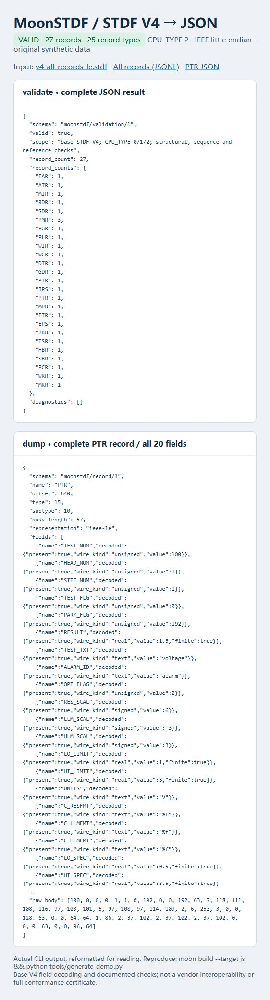

# 基于MoonBit的通用STDF V4解析库 MoonSTDF

[](https://github.com/0607272/MoonSTDF/actions/workflows/ci.yml)

MoonBit 实现的通用 STDF V4 二进制解码库与离线数据工具链。**完整支持基础 STDF V4 的 25 种在用记录及全部标准字段解析**，把文件转换为可复用的命名字段、原始记录和诊断，供数据转换、归档、文件审计及测试分析使用。Node CLI 与浏览器工作台共用 MoonBit 核心。

支持 CPU_TYPE 0/1/2（VAX F/D、IEEE 大端/小端）、可选尾部与 GDR 全部数据类型；提供文件顺序、跨记录引用和生命周期检查。完整解析的接口、逐记录矩阵及可复现证据见 [支持范围](docs/compatibility.md)。通用性体现在对不同 ATE 来源和上层应用复用同一套格式 API；实际厂商兼容性需用各自文件验证。V4-2007 为独立扩展，不属于本版本的基础 V4 解析承诺。

## 项目范围说明

**已实现完整支持 STDF V4 基础标准的全部 25 种在用记录类型及全部标准字段解析。** 本项目面向半导体测试数据通用分析场景，可适配多类型测试机台，不局限单一垂直产线；适配依据是标准格式，不包含未经验证的厂商私有扩展。解析终点为：**文件读取 → 记录解析 → 结构化校验 → 导出 JSON/JSONL**，输出可用于测试数据分析、可视化、数据库入库及长期归档。

| 分类 | 已支持记录（REC_TYP/REC_SUB） | 状态 |
|---|---|---|
| 文件与审计 | FAR 0/10、ATR 0/20 | 已支持 |
| 批次与汇总 | MIR 1/10、MRR 1/20、PCR 1/30、HBR 1/40、SBR 1/50 | 已支持 |
| 引脚、复测与站点 | PMR 1/60、PGR 1/62、PLR 1/63、RDR 1/70、SDR 1/80 | 已支持 |
| 晶圆 | WIR 2/10、WRR 2/20、WCR 2/30 | 已支持 |
| 芯片 | PIR 5/10、PRR 5/20 | 已支持 |
| 测试汇总 | TSR 10/30 | 已支持 |
| 测试结果 | PTR 15/10、MPR 15/15、FTR 15/20 | 已支持 |
| 程序段 | BPS 20/10、EPS 20/20 | 已支持 |
| 通用数据与文本 | GDR 50/10、DTR 50/30 | 已支持 |

逐记录状态、字段数和验证入口见根目录 [SUPPORT.md](SUPPORT.md)。完整字段解析不等于穷尽全部业务规则的符合性认证；V4-2007 扩展、压缩封装和 STDF 写回不在本期范围。

开源价值：为 MoonBit 应用提供可复用的半导体 STDF 格式组件，减少各工具重复实现二进制解析。2026-11-18 在 Mooncakes 以 `stdf` 检索未发现同类包；该检索范围不代表全网唯一。

## 评审快速验证与输出截图

已上传原创合成 [样例 STDF V4 文件](fixtures/v4-all-records-le.stdf)：1,149 字节、27 条记录，覆盖全部 25 种类型和全部字段；无需真实产线数据。可下载 [完整记录 JSONL](examples/output/records.jsonl)、[结构化校验 JSON](examples/output/validation.json) 和 [完整 PTR 记录 JSON](examples/output/ptr-record.json)。

```sh
moon build --target js --deny-warn
python tools/generate_demo.py
```

该脚本先调用真实 CLI 校验样例，通过后导出所有记录，并重建以上 JSON 和 [本地输出预览](examples/output/preview.html)。预期结果：`valid: true`、`record_count: 27`、25 种类型、无诊断。截图来自该预览对真实 CLI JSON 的展示，上方为完整校验结果，下方为 PTR 全部字段：



只验证 MoonBit 库、不需要 Python 或 Node 时：`moon run examples/demo --target wasm-gc`。源码见 [最小 Demo](examples/demo/main.mbt)，内嵌完整最小文件，演示分帧、命名字段访问、校验和 JSON 输出。

## 快速开始

安装 [MoonBit 官方工具链](https://www.moonbitlang.com/download/)；本项目验证版本为 `moonc v0.10.20+65efd5b93`、`moon 0.1.20261104`。CLI 需要 Node.js 22+，辅助脚本需要 Python 3.10+。核心库无第三方运行时依赖。无需 Python 包安装。

```sh
git clone https://github.com/0607272/MoonSTDF.git
cd MoonSTDF
moon check --target all --deny-warn
moon test --target wasm-gc --deny-warn
moon run examples/demo --target wasm-gc
moon build --target js --deny-warn
node _build/js/debug/build/cmd/main/main.js analyze fixtures/lot-a-le.stdf
```

业务样本产生 27 条记录、2 个芯片观测、1 通过 / 1 失败、良率 `0.5`；PTR 100 均值 `2.5 V`。PMR 等已识别记录在 JSON 的 `ancillary_records` 中输出；便携示例另用内嵌的完整最小文件，6 条记录、1 颗通过，并演示跨块分帧、命名字段访问及文件校验。

## 文件分析、比较与复测

完整字段转换与文件审计：

```sh
node _build/js/debug/build/cmd/main/main.js dump fixtures/v4-all-records-le.stdf --output records.jsonl
node _build/js/debug/build/cmd/main/main.js validate fixtures/v4-all-records-vax.stdf
```

`dump` 的每行包含全部标准字段、明确的缺失标记、原始记录体和源偏移，适合接入数据库或独立分析系统。`validate` 返回各类型计数和带偏移诊断，有问题时退出 2。流式导出失败时可能留下有效前缀，调用方必须检查退出码。应用统计使用以下入口：

```sh
node _build/js/debug/build/cmd/main/main.js analyze fixtures/lot-a-le.stdf --format html --output lot.html
node _build/js/debug/build/cmd/main/main.js analyze fixtures/lot-a-le.stdf --format csv --output parts.csv
node _build/js/debug/build/cmd/main/main.js analyze fixtures/lot-a-le.stdf --policy last --identity coordinates
node _build/js/debug/build/cmd/main/main.js compare fixtures/lot-a-le.stdf fixtures/lot-b-le.stdf
node _build/js/debug/build/cmd/main/main.js retest fixtures/lot-a-le.stdf fixtures/retest-le.stdf --identity coordinates
```

比较样本的 PTR 均值差为 `+1 V`；复测样本匹配 2 颗、恢复 1 颗、退化 0 颗。比较要求测试种类、编号、单位、上下限及等号策略一致；差异或缺失条件产生诊断。跨文件复测要求配对唯一；重复、缺失和冲突身份会报告，不能据此自动判定量产放行。

分析 CLI 默认输出 JSON，可用 `--output PATH` 保存；父目录须已存在，输出不得覆盖任何输入。结构错误返回退出码 2；分析层诊断保留在报告中，`compare` / `retest` 的源诊断标注 before/after。`--help` 查看参数。文件每次读取 64 KiB，默认每文件上限 256 MiB / 1,000,000 条记录。解析有界，但分析保留芯片观测与未投影记录，内存不恒定。

## 可复现使用场景

- 数据接入与归档：数据平台开发者将不同 ATE 的未压缩基础 V4 文件交给 `dump`，获得命名字段 JSONL、原始字节和偏移，接入数据库或归档系统；示例 `dump fixtures/v4-all-records-le.stdf` 覆盖 25 种记录。
- 文件质量审计：实验室或工具维护者在批量入库前运行 `validate`，检查记录顺序、必需记录、引脚引用及芯片/晶圆配对，获得可定位的诊断和退出码，决定是否隔离异常文件；`validate fixtures/malformed-truncated.stdf` 返回 2。
- 工程分析与复测：测试/工艺工程师使用 `analyze` 查看芯片、良率、分布与坐标，使用 `retest fixtures/lot-a-le.stdf fixtures/retest-le.stdf` 获得 2 颗配对、1 颗恢复，或以 `compare` 比较批次；样例 PTR 均值差为 `+1 V`。

## 浏览器本地分析

```sh
moon build --target js --deny-warn
python tools/build_web.py
```

直接在浏览器打开 `web/index.html`，选择合成样本或自己的未压缩 STDF V4 文件，可查看测试项分布、SVG 晶圆坐标图并下载 JSON/HTML。页面不上传文件、不请求 CDN。编译产物 `web/moonstdf.js` 由以上命令生成，不纳入源码。页面在主线程分析，接近资源上限的文件可能短暂阻塞界面；浏览器入口目前提供单文件观测分析，复测与比较使用 CLI。

## MoonBit API

在 MoonBit 工程的 `moon.pkg` 中导入 `"0607272/moonstdf"`，并使用本地路径依赖或源码检出；当前尚未发布 Mooncakes 包。

```moonbit
fn inspect_file(data : Bytes) -> String raise @moonstdf.StdfError {
  let analysis = @moonstdf.analyze(data)
  @moonstdf.report_json(analysis)
}
```

大文件可用 `Framer::new().feed(chunk)` 获得 `Frame`，逐条传给 `Analyzer::accept`，在 EOF 依次调用两者的 `finish()`。遇到错误后对象关闭，不可继续使用；直接传 Frame 也校验 FAR、字节序、体长及预算。`Analyzer::new(max_bytes=..., max_records=...)` 可配置小于默认值的预算。完整 API 见 [生成接口](pkg.generated.mbti) 与 [便携示例](examples/demo/main.mbt)。

需要全部字段时，对每条帧调用 `decode_v4_record(frame)`（返回 `V4Record?`），通过 `record.fields` 或 `record.field("字段名")` 读取，原始字节位于 `record.frame`。`v4_record_json(frame)` 生成完整导出，`validate_v4(data)` 或增量 `V4Validator` 提供校验；分析报告只投影统计需要的字段。

## 统计口径

- 默认保留所有完成的芯片观测；良率 = 正常通过 /（正常通过 + 正常失败）。未知、异常结束单列且不进分母，空分母为 `null`。
- PTR/MPR 数值已经是基本单位；显示缩放不参与数值计算。按首条同类同号记录建立不可变基线，后续覆盖只影响当前记录。
- 分布只纳入有限且质量有效的数值；失败但数值有效的样本仍可参与分布。MPR 多个值增加样本数，不增加执行数；标准差采用总体口径。
- `first` / `last` 必须显式选择，并指定 `coordinates` 或 `part-id` 身份。坐标键含 lot/wafer；缺失和冲突不会被静默合并。选择后停用与全文件汇总的直接比较。
- 晶圆图采用原始逻辑坐标，不转换物理方向；重复坐标按后观测覆盖并显式提示。坐标不等于全球唯一芯片标识。

## 验证与持续集成

```sh
moon fmt --check
moon info
git diff --exit-code -- '*.mbti'
moon check --target all --deny-warn
moon build --target wasm --deny-warn
moon test --target wasm --deny-warn
moon build --target wasm-gc --deny-warn
moon test --target wasm-gc --deny-warn
moon build --target js --deny-warn
moon test --target js --deny-warn
python tools/generate_fixtures.py --check
python tools/generate_v4_coverage.py --check
python tools/test_cli.py
python tools/test_v4_coverage.py
python tools/generate_demo.py --check
python tools/build_web.py
python tools/test_web.py
```

CI 覆盖 JS / Wasm / WasmGC 的 check、build、test 和运行示例，另校验格式、接口漂移、样本可复现性与 CLI/浏览器共享核心一致性。Native 尚未列为支持目标；Windows 本地缺少 MSVC Build Tools，未完成 Native 运行验证。浏览器核心已在 Node 下验证，实际浏览器布局和文件选择流程仍需交互验证。

所有二进制样本均为原创合成数据，见 [fixtures](fixtures/README.md)。全字段样本覆盖 25 种记录及 LE/BE/VAX，使用独立 Python 编码器与已知值核对；另有 5 个业务样本以 MIT 解码器 Semi-ATE-STDF 0.1.28 对照部分字段。两类证据均不等于覆盖所有厂商文件。见 [来源与许可证](docs/provenance.md)。

## 限制与后续方向

不支持 STDF V4-2007 扩展、压缩封装、ATDF、写回 STDF、硬件采集、SPC 显著性检验或完整标准符合性认证。汇总记录的一致性检查也不能证明输入文件完整。后续可扩展厂商样本验证、PMR 引脚投影和 Worker 分析入口。

源码与原创合成样本采用 [MIT](LICENSE) 许可证。
